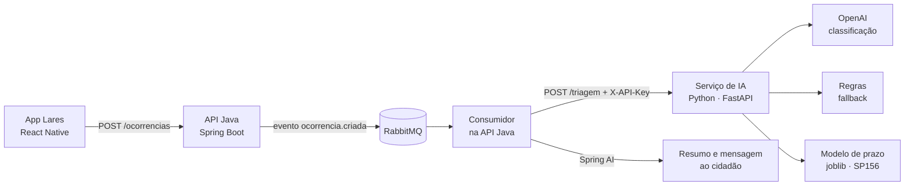

# Lares — Serviço de IA

**Projeto:** Lares, zeladoria colaborativa (Global Solution 2026/2 · CitizenTech)

**Equipe:** Driven Soft

**Matéria:** Disruptive Architectures: IoT, IoB & Generative IA

**Repositórios integrados:** [LaresApi-Java](https://github.com/Driven-Soft/LaresApi-Java) · [Lares-Mobile](https://github.com/Driven-Soft/Lares-Mobile)

### Integrantes

| Nome | RM |
| --- | --- |
| Felipe Bezerra Beatrici | RM 564723 |
| Max Hayashi Batista | RM 563717 |
| Henrique Cunha Torres | RM 565119 |
| Lucas da Silva Lima | RM 562118 |
| Yasmin Nathalin Miranda dos Santos | RM 561365 |

## Sumário

1. [O problema e o público](#1-o-problema-e-o-público)
2. [O que a IA faz](#2-o-que-a-ia-faz)
3. [Arquitetura e fluxo](#3-arquitetura-e-fluxo)
4. [Modelos, tecnologias e justificativas](#4-modelos-tecnologias-e-justificativas)
5. [Dados](#5-dados)
6. [Estrutura do repositório](#6-estrutura-do-repositório)
7. [Como executar](#7-como-executar)
8. [Contrato da API](#8-contrato-da-api)
9. [Testes e avaliação](#9-testes-e-avaliação)
10. [Limitações](#10-limitações)
11. [Uso responsável](#11-uso-responsável)
12. [Uso de IA generativa no desenvolvimento](#12-uso-de-ia-generativa-no-desenvolvimento)

---

## 1. O problema e o público

O morador de São Paulo que vê um buraco, um poste apagado ou lixo acumulado reclama e não sabe se alguém viu, nem quanto tempo vai demorar. Do outro lado, a prefeitura recebe relatos escritos de qualquer jeito e precisa decidir o que atender primeiro.

O Lares resolve as duas pontas. O cidadão registra o problema pelo app e o gestor da prefeitura trabalha numa fila ordenada por prioridade. **A IA é quem faz a triagem**: ela lê o relato livre, define a categoria e a prioridade e estima o prazo de atendimento.

- **Público beneficiado:** cidadãos (resposta e prazo realista) e gestores públicos (fila priorizada e relatos já classificados).
- **Tema CitizenTech:** ODS 11 (cidades e comunidades sustentáveis) e ODS 10 (redução das desigualdades: os prazos por distrito mostram onde se espera mais).

## 2. O que a IA faz

O serviço expõe um endpoint, `POST /triagem`, que recebe a descrição e o bairro de uma ocorrência e devolve:

| Saída | Como é obtida |
| --- | --- |
| `categoria` (7 opções) e `prioridade` (BAIXA, MEDIA, ALTA) | **IA generativa:** um LLM da OpenAI lê o relato e responde em JSON com schema fixo |
| `prazoEstimadoDias` | **Machine Learning:** regressão treinada com as solicitações reais do SP156 |
| `origem` | `llm`, ou `fallback` quando o LLM falha e entram as regras de palavra-chave |

### A função do LLM e o valor que ele agrega

O LLM faz a **triagem do relato**. Ele lê o texto livre do cidadão ("tem uma cratera na frente da escola, carro já furou pneu") e devolve a categoria, a prioridade, uma confiança de 0 a 1 e uma justificativa curta. A API Java também usa um LLM (Spring AI), mas só para escrever o resumo ao gestor e a mensagem ao cidadão; a classificação é feita aqui.

- **O cidadão escreve do jeito dele:** não precisa escolher a categoria certa nem conhecer o vocabulário da prefeitura. O LLM entende gíria ("farol" no lugar de semáforo), erro de digitação e relatos ambíguos.
- **A fila do gestor já chega priorizada:** a prioridade considera o contexto ("perto da escola", "fio soltando faísca", "idosa caiu"), e o que oferece risco é atendido primeiro.
- **Viabiliza o modelo de prazo:** o ML precisa da categoria, e é o LLM que transforma o texto livre nela.
- **A decisão é explicável:** a justificativa mostra o porquê da classificação, para o gestor confirmar ou corrigir.
- **Filtra o ruído:** pedidos sem relação, textos ofensivos ou tentativas de manipular o prompt viram OUTROS/BAIXA e não poluem a fila.

**Por que não só regras ou só ML:**
- As regras de palavra-chave dependem de termos exatos: quem escreve "breu" ou "farol" fora da lista cai em OUTROS. Por isso elas ficam só como fallback, para a triagem não parar se a OpenAI falhar.
- Um classificador de ML tradicional precisaria de milhares de relatos rotulados, e o SP156 não publica o texto das reclamações. O LLM funciona sem dataset de treino.

Em resumo: o LLM transforma um relato desorganizado num chamado classificado, priorizado e explicado, em segundos, reduzindo a triagem manual da prefeitura.

## 3. Arquitetura e fluxo



1. O cidadão registra a ocorrência no app; a API Java grava como `RECEBIDA` e publica um evento.
2. O consumidor chama o `POST /triagem` deste serviço.
3. O serviço classifica com o LLM (ou com as regras, se o LLM falhar) e estima o prazo com o modelo.
4. A API Java grava o resultado, gera os textos com o Spring AI e muda o status para `TRIADA`.

O serviço é stateless: não acessa banco e não guarda os relatos.

## 4. Modelos, tecnologias e justificativas

| Parte | Escolha | Por quê |
| --- | --- | --- |
| Classificação | LLM da OpenAI (`gpt-4.1-mini`, configurável) com Structured Outputs | O relato é texto livre, com gíria e erro de digitação; um LLM entende isso sem precisar de um dataset de treino de reclamações, que o SP156 não publica. O schema JSON fixo garante uma resposta que a API Java consegue ler |
| Fallback | Regras de palavra-chave | A triagem não pode parar se a OpenAI estiver fora do ar; as regras são determinísticas e auditáveis |
| Prazo | `HistGradientBoostingRegressor` (scikit-learn) com perda absoluta e categoria/distrito como features categóricas nativas | O prazo é um número que depende de dados reais da cidade, e o LLM não sabe quanto São Paulo demora. A perda absoluta otimiza o erro em dias e é robusta aos poucos casos muito demorados. As categorias nativas aprendem melhor a combinação categoria × distrito: o mesmo modelo com one-hot errou 1 dia a mais (MAE de 17,5 contra 16,6). Baseline: mediana por categoria |
| Serviço | Python, FastAPI, Pydantic | Mesmo padrão do serviço de IA do Fidelis; validação de entrada e contrato documentado no Swagger (`/docs`) |
| Hospedagem | Render (plano free) | O serviço precisa ficar no ar para a API Java durante a correção |

## 5. Dados

### SP156 (modelo de prazo)
- **Fonte:** [Dados do SP156 — Solicitações](https://dados.prefeitura.sp.gov.br/dataset/dados-do-sp156), Prefeitura de São Paulo, licença CC0. Dados pessoais já removidos pela prefeitura.
- **Período usado:** os quatro trimestres de 2025.
- **Campos usados:** data de abertura, data de finalização, serviço, status e distrito. O SP156 não publica o texto da reclamação nem o bairro.
- **Preparação** (`pipeline/prepare_dataset.py`):
  1. mantém só as solicitações finalizadas (2,19 milhões das 2,62 milhões de 2025);
  2. mapeia o serviço do SP156 para uma categoria do Lares por uma lista de termos e descarta o que não é zeladoria relatada pelo cidadão, como pedidos de instalação, autorizações e serviços em área particular (o resultado fica em `data/mapeamento_servicos.csv`);
  3. calcula os dias entre a abertura e a finalização e descarta valores fora de 0 a 365 dias.
- **Resultado:** 426 mil solicitações em 96 distritos (`data/sp156_prazos.csv`).
- **Features:** categoria, distrito e mês de abertura. **Alvo:** dias até a finalização.
- **Iluminação pública não está no SP156 de 2025** (é atendida por outro canal da prefeitura). Para ILUMINACAO e OUTROS, o serviço devolve o prazo padrão da categoria.

### Descrições rotuladas (avaliação da triagem)
`data/triagem_rotulada.csv`: relatos escritos como um cidadão escreveria, com a categoria e a prioridade esperadas. O conjunto mistura casos claros, ambíguos, com erro de digitação e sem relação com zeladoria.

## 6. Estrutura do repositório

```
Lares-IA/
├── data/
│   ├── triagem_rotulada.csv      # relatos rotulados para avaliar a triagem
│   ├── sp156_prazos.csv          # gerado pelo prepare_dataset.py
│   ├── mapeamento_servicos.csv   # gerado pelo prepare_dataset.py
│   └── sp156/                    # CSVs brutos (fora do git)
├── pipeline/
│   ├── baixar_dados.py           # baixa o SP156 de 2025
│   ├── prepare_dataset.py        # limpa e mapeia para as categorias do Lares
│   ├── treinamento_modelo.py     # treina o modelo de prazo
│   ├── avaliacao_modelo.py       # gera docs/AVALIACAO_PRAZO.md
│   └── avaliacao_triagem.py      # gera docs/AVALIACAO_TRIAGEM.md
├── servico_ia/
│   ├── main.py                   # FastAPI: /triagem e /health
│   ├── classificador.py          # chamada à OpenAI e validação da resposta
│   ├── regras.py                 # fallback por palavra-chave
│   ├── prazo.py                  # modelo de prazo (ou prazo padrão)
│   ├── categorias.py             # categorias, prioridades e prazos padrão
│   ├── texto.py                  # normalização de texto
│   ├── modelo/                   # modelo_prazo.joblib
│   ├── tests/                    # pytest
│   └── .env.example
└── docs/                         # relatórios de avaliação
```

## 7. Como executar

### Serviço
```bash
python3 -m venv .venv
source .venv/bin/activate
pip install -r servico_ia/requirements-dev.txt

cd servico_ia
cp .env.example .env          # e preencha a OPENAI_API_KEY
uvicorn main:app --reload --port 8000
```
Swagger em http://localhost:8000/docs. Sem a `OPENAI_API_KEY`, o serviço funciona só com as regras.

### Testes
```bash
cd servico_ia
pytest -v
```
Os testes não chamam a OpenAI.

### Treinamento e avaliação (na raiz do repositório)
```bash
python pipeline/baixar_dados.py
python pipeline/prepare_dataset.py
python pipeline/treinamento_modelo.py
python pipeline/avaliacao_modelo.py
python pipeline/avaliacao_triagem.py     # usa a OPENAI_API_KEY do servico_ia/.env
```

### Deploy no Render
Web Service com:
- **Root Directory:** `servico_ia`
- **Build Command:** `pip install -r requirements.txt`
- **Start Command:** `uvicorn main:app --host 0.0.0.0 --port $PORT`
- **Variáveis de ambiente:** `OPENAI_API_KEY`, `LARES_IA_API_KEY` (a chave que a API Java manda), `OPENAI_MODEL` (opcional) e `PYTHON_VERSION=3.12.3`

## 8. Contrato da API

```jsonc
// POST /triagem   (header X-API-Key quando LARES_IA_API_KEY está definida)
{ "descricao": "Buraco enorme na frente da escola", "bairro": "Vila Mariana" }

// 200
{ "categoria": "BURACO", "prioridade": "ALTA", "confianca": 0.87,
  "prazoEstimadoDias": 12, "origem": "llm" }
```

- `categoria`: `BURACO`, `ILUMINACAO`, `LIXO`, `CALCADA`, `ARVORE`, `SINALIZACAO` ou `OUTROS`.
- `origem`: `llm`, ou `fallback` quando as regras assumiram.
- Erros: 401 (X-API-Key ausente ou errada) e 422 (descrição vazia ou com mais de 500 caracteres).
- `GET /health`: status, se o LLM está configurado e as métricas do modelo de prazo.

## 9. Testes e avaliação

- **Testes automatizados** (`servico_ia/tests`): contrato da API, validação de entrada, autenticação, fallback, leitura e validação da resposta do LLM (com cliente falso, sem rede), regras e modelo de prazo.
- **Avaliação da triagem** ([docs/AVALIACAO_TRIAGEM.md](docs/AVALIACAO_TRIAGEM.md)):
  - acurácia e F1 da categoria e acurácia da prioridade, para o LLM e para as regras;
  - matriz de confusão e os erros com a justificativa do LLM;
  - casos de falha: texto vazio, longo demais, sem relação, ofensivo, tentativa de manipular o prompt e LLM indisponível.
- **Avaliação do prazo** ([docs/AVALIACAO_PRAZO.md](docs/AVALIACAO_PRAZO.md)): MAE do modelo contra o baseline, geral e por categoria, e o prazo estimado por distrito.

| Triagem (28 relatos rotulados) | LLM (`gpt-4.1-mini`) | Regras (fallback) |
| --- | --- | --- |
| Acurácia da categoria | 100% | 96% |
| Acurácia da prioridade | 93% | 82% |
| Tempo médio por chamada | 1,0 s | — |

O LLM acerta todas as categorias; os erros são de prioridade em casos de fronteira (ex.: "placa de pare caída" saiu MEDIA, esperado ALTA). O conjunto ainda é pequeno: relatos difíceis, com gíria e ambiguidade, devem baixar esses números. A chamada usa temperatura 0, para que o mesmo relato receba a mesma triagem. Nos casos de falha, pedidos sem relação, ofensivos ou com tentativa de manipular o prompt viram OUTROS/BAIXA, e com a OpenAI fora do ar a triagem continua pelas regras.

| Prazo (85 mil solicitações de teste) | Valor |
| --- | --- |
| MAE do modelo | 16,6 dias |
| MAE do baseline (mediana por categoria) | 18,2 dias |
| Ganho sobre o baseline | 9% |
| Acerto em até 7 dias | 69% |

O erro é pequeno em LIXO (3,8 dias) e BURACO (12,7) e grande em ÁRVORE (45,8) e CALÇADA (54,9), categorias em que parte das solicitações demora meses.

## 10. Limitações

- A `confianca` vem do próprio LLM: é uma autoavaliação, não uma probabilidade calibrada.
- O LLM pode errar em relatos ambíguos (ex.: raiz de árvore quebrando a calçada). O gestor pode corrigir a categoria no app.
- As regras de fallback só reconhecem as palavras-chave da lista.
- O modelo de prazo só vê categoria, distrito e mês: não conhece a gravidade descrita nem a fila atual das equipes. Por isso o erro é alto em ÁRVORE e CALÇADA, em que o prazo varia muito.
- ILUMINACAO não tem dados no SP156 de 2025 e usa o prazo padrão.
- O bairro digitado só é usado quando tem o mesmo nome de um distrito oficial de São Paulo.
- Os dados são de São Paulo; para outra cidade, o modelo precisa ser treinado de novo.

## 11. Uso responsável

- **Credenciais:** as chaves ficam em `servico_ia/.env` (fora do git) ou nas variáveis do Render. O repositório só tem o `.env.example`.
- **Dados pessoais:** o SP156 já vem sem dados pessoais. O serviço não grava os relatos e não registra o texto deles em log, porque o cidadão pode escrever nomes ou endereços.
- **Manipulação do prompt:** o relato vai como mensagem do usuário, e o prompt de sistema manda ignorar instruções dentro dele. A resposta só é aceita se seguir o schema e as listas de categoria e prioridade.
- **Decisão humana:** a IA sugere; o gestor confirma ou corrige a categoria antes de atender.